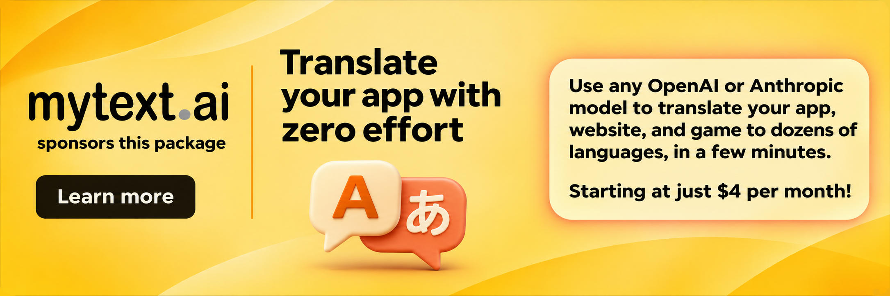

* Sponsored by [MyText.ai](https://mytext.ai)

## 1.2.3

* Migrate the Flutter example to package:material_ui for Flutter 3.50. Keep the Dart library SDK constraint and byte-array equality compatible with older Dart versions.

## 1.2.2

* Dart-only.

## 1.1.0

* Enums `OpenAiModel` and `TiktokenEncodingType` now have `toJson` and
  `fromJson` methods.

## 1.0.2

* Supports: Gpt-4, Gpt-4o, Gpt-4o-mini, o1, o1-mini, and o1-preview.
